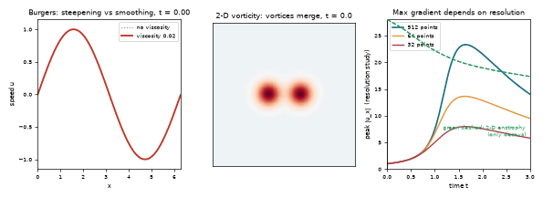
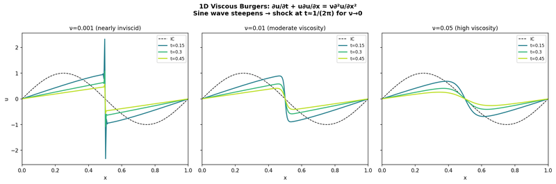
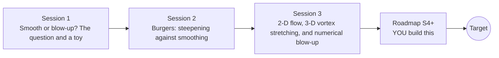

# openregularity

[](https://github.com/KrunalPanchal1995/openregularity/actions/workflows/ci.yml)   [](https://colab.research.google.com/github/KrunalPanchal1995/openregularity/blob/main/sessions/session-01/lesson.ipynb) [](https://krunalpanchal1995.github.io/openregularity/)

**Learn what is known, and what is still unknown, about smooth fluid flow.**

openregularity teaches the Navier-Stokes smoothness problem (a Clay Millennium Prize problem that is still OPEN) using small numerical experiments on simpler models, with Python and a browser.

- **Be honest about the unknown.** The 3-D smoothness question is open; every session says so plainly and teaches what is known.
- **See the mechanism.** A shock forming in Burgers and vortex stretching in 3-D are shown on small, checkable models.
- **Know you got it right.** Checkpoints compare solvers with exact solutions and print PASS or FAIL.
- **Learn to doubt a blow-up.** An under-resolved run that explodes is not evidence of a singularity; you will see why.

[Target](#the-target) · [Who is this for](#who-is-this-for) · [Quick start](#quick-start) · [Sessions](#sessions) · [Roadmap](#roadmap) · [Contribute](#contribute) · [Explainer PDF](docs/explainer.pdf)

> **This repo is incomplete on purpose.** Sessions 1 to 3 are here and fully working. The finished Target below is a preview of what the community can build next. We show you the path, not the code. Sessions 4 and up are yours.

## The Target

Three panels. Left: a smooth wave steepens; without viscosity it would overturn (dotted), with viscosity it forms a thin but smooth front. Middle: two 2-D vortices merge. Right: the maximum gradient of the Burgers front measured at 32, 64 and 512 grid points: coarse grids report a much smaller peak, so resolution decides what you see. The 2-D enstrophy (green dashed) only decays. Your goal over the coming sessions: reproduce this kind of study yourself and learn to read numerical evidence carefully. Nothing in the Target answers the 3-D Navier-Stokes question; that question is open.



*Target: Burgers steepening and smoothing, 2-D vortex merger, and a resolution study of the peak gradient*



*From the author's CFD teaching project: viscous Burgers, a sine wave steepening for three viscosities*

Try it live:

- [Math Visual Studio: fluid kinematics (Atlas S58)](https://krunalpanchal1995.github.io/studio/#atlas?ch=S58&ex=1)
- [Math Visual Studio: conservation laws for fluids (Atlas S59)](https://krunalpanchal1995.github.io/studio/#atlas?ch=S59&ex=1)

How the Target was made is shown only as a path in [promo/roadmap.md](promo/roadmap.md).

## Who is this for
**higher secondary to diploma / undergraduate (levels 4-5).** Topic area: Heat, Thermodynamics and Fluid Mechanics.

Prerequisites:

- Calculus (derivatives and integrals) and the idea of a differential equation; first or second year undergraduate level.
- Python 3.10 or newer; if `python --version` works, you are ready. PRIMER.md explains the rest.
- No prior fluid mechanics, GitHub or Fourier analysis is needed; every symbol is explained.

New to Python? Read [PRIMER.md](PRIMER.md) first (10 minutes).

## Quick start

No installation knowledge needed. You need [Git](https://git-scm.com/downloads) and [Python 3.10+](https://www.python.org/downloads/) (Windows: tick "Add Python to PATH"). On Mac and Linux type `python3` wherever this page says `python`.

```bash
git clone https://github.com/KrunalPanchal1995/openregularity.git
cd openregularity
python start.py 1
```

`start.py` creates a private environment, installs what is needed and runs Session 1 with its checkpoint. Next: `python start.py 2`, `python start.py 3`, or `python start.py test` to check everything. Only a checkpoint: `python start.py check 1`.

Four lines turn the idea of Session 1 into a result (they work as they are): Save it as `try.py` and run it with `python start.py run try.py` (this uses the private environment, where NumPy is installed):

```python
import numpy as np
y0 = 2.0                                  # dy/dt = y^2 starting from y0 = 2
print('blow-up time', 1 / y0)             # -> 0.5: y becomes infinite in finite time
print('y at t = 0.4:', round(y0 / (1 - y0 * 0.4), 3))   # -> 10.0 and still climbing
```

Every session also opens in your browser with sliders (no install): [live apps](https://krunalpanchal1995.github.io/openregularity/). Or use the Colab badge above for the notebook.

## Sessions

| # | Session | Model level | Time | Live app |
|---|---|---|---|---|
| 1 | [Smooth or blow-up? The question and a toy](sessions/session-01/README.md) | Level 1: conceptual interactive model | 60 min | [open](https://krunalpanchal1995.github.io/openregularity/session-01/) |
| 2 | [Burgers: steepening against smoothing](sessions/session-02/README.md) | Level 2: mathematical engineering model | 75 min | [open](https://krunalpanchal1995.github.io/openregularity/session-02/) |
| 3 | [2-D flow, 3-D vortex stretching, and numerical blow-up](sessions/session-03/README.md) | Level 3: simulation and validation | 90 min | [open](https://krunalpanchal1995.github.io/openregularity/session-03/) |

Each session follows the same six steps: A real-world problem, B concept and theory, C visual explanation, D interactive simulation, E worked example and experiment, F assessment and design challenge. Each ends with `checkpoint.py`, which prints `PASS` or `FAIL` against reference numbers. Session 3 also contains the real-world mini-project: **How many Fourier modes does a thin front need?**.

## Architecture



| Folder or file | What is inside |
|---|---|
| `sessions/` | three sessions: README (A-F), `lesson.py`, notebook, live app, exercises, activity sheet, checkpoint |
| `promo/` | the Target: media, live links, and the roadmap (path only) |
| `docs/` | `explainer.tex` and the built `explainer.pdf` |
| `tests/` | runs every lesson and checkpoint headless |
| `start.py` | one command to set up and run anything |
| `QUALITY.md`, `RUBRIC.md` | the quality checklist and the scoring rubric |
| `.github/` | CI, PDF build, Pages deploy, issue and PR templates |

## Roadmap

| Milestone | What you will build | Difficulty |
|---|---|---|
| Session 4: A 3-D pseudo-spectral solver | A 3-D periodic solver started from the 3-D Taylor-Green field. | advanced |
| Session 5: Track the maximum vorticity | A study of max \|w\|(t) for two or three 3-D initial fields, with the Beale-Kato-Majda integral. | advanced |
| Session 6: Read about Euler blow-up claims and computer-assisted proofs | A one-page reading summary that labels every claim as proved, supported by numerical evidence, or open. | intermediate |
| Session 7: Higher-precision Cole-Hopf | A high-precision version of the exact Burgers solution. | intermediate |
| Session 8: A cheaper resolution | A variant of the Burgers solver that places points where the front is. | advanced |

Full detail with a checkpoint per milestone: [promo/roadmap.md](promo/roadmap.md).

## Contribute
New to GitHub? Read [CONTRIBUTING.md](CONTRIBUTING.md); it starts from zero. Pick an issue labelled `good first issue`. Translations into Hindi, Telugu, Tamil and Malayalam are welcome.

<details>
<summary>Development</summary>

```bash
python start.py test        # runs every lesson and checkpoint
```
Lessons use `# %%` cell markers so they open as notebooks in VS Code. See [QUALITY.md](QUALITY.md) for the standard every session meets.
</details>

## License
MIT. See [LICENSE](LICENSE). Media in `promo/media` is (c) Krunal Panchal, CC BY 4.0.

## Acknowledgments
Part of the [PAN IIT OSS](https://hellofoss.tech-iitb.org/projects) open-source teaching collection, modelled on the structure of [openspline](https://github.com/openspline/openspline). Built on ideas from the Math Visual Studio at https://krunalpanchal1995.github.io/studio/.
