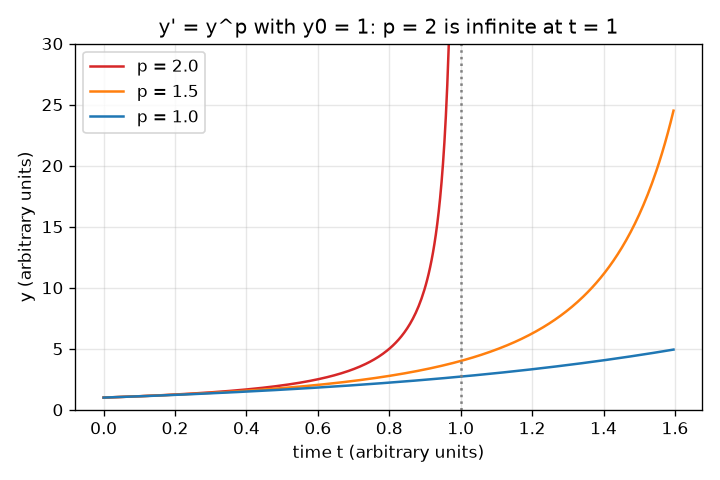
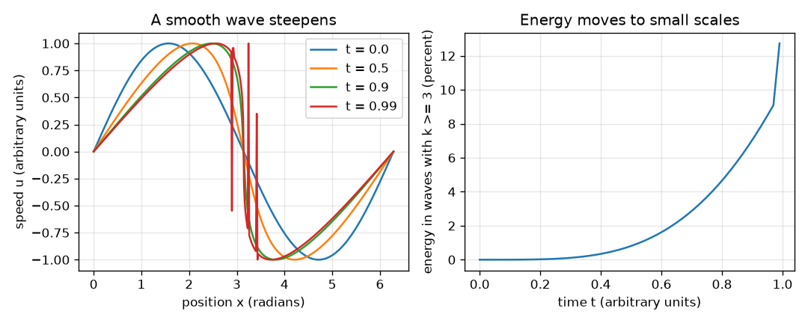

# Session 1: Smooth or blow-up? The question and a toy

*Level 1 (conceptual interactive model) · about 60 minutes · openregularity*

> This is a simplified educational model. It is not a validated design tool and must not be used for real structures, electrical installations, vehicles, industrial processes or medical decisions.

**Prerequisites**

- Derivatives; the idea that dy/dt = f(y) describes how y changes in time.
- You have read PRIMER.md and run `python start.py 1` once.

**Learning objectives.** After this session you can:

- Explain in plain words what the Navier-Stokes smoothness problem asks, and say clearly that it is open.
- Show, with a formula and a computer, that dy/dt = y^2 becomes infinite at t = 1/y0, while dy/dt = y never does.
- Say why a smooth wave that steepens moves its energy to small scales.
- Read a graph of a quantity approaching infinity at a finite time.

## A. Real-world problem
Air in a room, water in a pipe and smoke from a candle are all described by the Navier-Stokes equations. Engineers solve them on computers every day. Yet one of the seven Clay Millennium Prize problems, stated by Fefferman, asks something very basic: if a 3-D flow of an ordinary fluid starts smooth, does it stay smooth for ever, or can its velocity gradient become infinite after a finite time? This is OPEN: nobody knows the answer, and this repo does not claim or attempt one. What we can do is understand what the question means and study toy models. How can a number that is finite now become infinite later at a definite time?

## B. Concept and theory
Navier-Stokes in plain words: the fluid velocity is carried along by itself (a nonlinear term) and smoothed by friction (viscosity). The question is whether the nonlinear steepening can ever beat the smoothing and produce infinite gradients in finite time. A toy for 'growth that feeds on itself' is dy/dt = y^p. For p = 2, separating variables gives y(t) = y0 / (1 - y0 t), which is infinite at t* = 1/y0; in general t* = 1/((p-1) y0^(p-1)) for p > 1. For p = 1 the solution y0 e^t is finite at every time. A second toy is the no-friction Burgers equation, where a sine wave steepens and its energy moves from one long wave to many short waves. Known results from the literature, in outline: Leray showed in the 1930s that weak (rough) solutions of 3-D Navier-Stokes exist for all time but without a proof that they are unique or smooth; local-in-time smooth solutions are known (work of Ladyzhenskaya, Kato and others); in 2-D smooth solutions exist for all time; the Beale-Kato-Majda criterion says a smooth solution can be continued as long as the time integral of the maximum vorticity stays finite. What is not known is global smoothness in 3-D.

| Symbol | Meaning | Unit |
|---|---|---|
| y | a positive quantity that grows (toy) | arbitrary units |
| y0 | starting value of y | arbitrary units |
| p | exponent in dy/dt = y^p | no unit |
| t* | blow-up time | arbitrary units |
| u | speed in the wave toy | arbitrary units |
| k | wavenumber: number of waves in the box 2 pi long | no unit |

**Assumptions**

- The equations are toys: they show a mechanism, they are not fluid mechanics.
- y0 > 0.
- The wave toy has no friction and is valid only until the shock time t = 1.

$$ \frac{dy}{dt}=y^{p} $$

$$ y(t)=\frac{y_0}{1-y_0 t}\quad(p=2),\qquad t^{*}=\frac{1}{y_0} $$

$$ t^{*}=\frac{1}{(p-1)\,y_0^{\,p-1}}\quad(p>1) $$

$$ u(x,t)=\sin X,\qquad x=X+t\sin X $$

## C. Visual explanation
The first figure plots y(t) for p = 2, 1.5 and 1 starting from y0 = 1. The p = 2 curve rises vertically at t = 1; the p = 1.5 curve does the same at t = 2; the p = 1 curve stays finite. The second figure shows the wave u = sin x at times 0, 0.5, 0.9 and 0.99: it steepens at x = pi. Next to it, the share of energy carried by waves with wavenumber 3 or more grows from 0 to about 7 percent at t = 0.9 and keeps growing.

*y' = y^p from y0 = 1: p = 2 and p = 1.5 blow up in finite time, p = 1 does not.*

*A smooth wave steepens (left) and its energy moves to short waves (right).*

## D. Interactive simulation
Run the lesson (`python start.py 1`), then open the live app: [Session 1: blow-up toy and steepening wave](https://krunalpanchal1995.github.io/openregularity/session-01/) (or `app.html` in this folder). Move the y0 and p sliders on the growth view and watch the blow-up time move; set p = 1 and see that there is none. Then open the wave view and drag the wave time towards 1.

**Challenge.** Make y blow up before t = 0.4, using an exponent p of at most 2.

## E. Worked example and experiment
**Problem.** For dy/dt = y^2 with y0 = 2, find the blow-up time and the value of y at t = 0.4. Check the blow-up time with a computer.

1. Separate variables: dy / y^2 = dt, so -1/y = t - 1/y0 + ..., which gives y(t) = y0 / (1 - y0 t).
2. y is infinite when the denominator is zero: t* = 1/y0 = 1/2 = 0.5.
3. At t = 0.4: y = 2 / (1 - 2 * 0.4) = 2 / 0.2 = 10.
4. The computer (RK4 with steps that shrink as y grows) reaches y = 1,000,000 at t = 0.499999, which equals 0.5 - 1/y within 1e-5. The numbers agree.

**Answer.** Blow-up at t* = 0.5; y(0.4) = 10.

**Experiment.** No fluid in a lab becomes infinite: real quantities saturate because the model stops being valid (for example molecules, compressibility or other physics enter). Compare: a rumour or a chain reaction grows fast but is limited by the finite population or fuel. So the question for Navier-Stokes is a question about the equations as mathematics, not a prediction that a real fluid forms an infinity. The model and reality differ because the model has no cut-off.

## F. Assessment and design challenge
**Question type A: Conceptual.** In one or two sentences, what does the Navier-Stokes smoothness problem ask, and what is its status?

Hint

Think about initial data that is smooth, time, and a gradient becoming infinite. Is it solved?

Step-by-step solution

It asks whether, for smooth starting data, a 3-D incompressible viscous flow always has a smooth solution for all later times, or whether some quantity such as the velocity gradient can become infinite in finite time. It is an open Clay Millennium Prize problem: neither answer has been proved.

**Question type B: Numerical.** For dy/dt = y^2, find the blow-up time for y0 = 4 and for y0 = 0.5. What happens to the time when y0 doubles?

Hint

Use t* = 1/y0.

Step-by-step solution

t* = 1/4 = 0.25 for y0 = 4 and t* = 1/0.5 = 2 for y0 = 0.5. Doubling y0 halves the blow-up time. Units: same time unit as t.

**Question type C: Graph and simulation interpretation.** On the growth view, which curve reaches the top of the plot first for y0 = 1: p = 2 or p = 1.5? What does p = 1 do?

Hint

Compare t* = 1 with t* = 2.

Step-by-step solution

p = 2 blows up at t = 1 and p = 1.5 at t = 2, so p = 2 is first. For p = 1 the curve is the exponential e^t, which keeps growing but is finite at every t: fast growth is not the same as blow-up.

**Question type D: Design and optimisation challenge.** Design: you are told y follows dy/dt = y^2 and the model is only trusted until t = 1.5. Find the largest starting value y0 for which no blow-up occurs before t = 1.5, and one reason the answer is only a model result.

Hint

You need t* = 1/y0 to be at least 1.5.

Step-by-step solution

1/y0 >= 1.5 gives y0 <= 0.667 (2/3). Reason it is only a model: real systems have physics left out that would stop the growth earlier or change it, and y0 would be known only to some accuracy, so a safety margin is needed.

Score yourself with [RUBRIC.md](../../RUBRIC.md). Print the [activity sheet](activity_sheet.md) to work on paper.

## Common misconceptions
| Common misconception | What is actually true |
|---|---|
| Fast growth means blow-up. | Exponential growth y0 e^t is fast but finite at every time. Blow-up needs growth that speeds up faster than exponentially, like dy/dt = y^2. |
| Mathematicians know that Navier-Stokes solutions blow up (or do not). | Neither is known for 3-D. It is an open problem; be suspicious of any simple claim that it is solved. |
| Engineers solve Navier-Stokes every day, so the problem must be solved. | Computers produce approximate solutions of particular flows over finite times. The open question is a mathematical statement about all smooth starting data and all times. |
| A smooth wave stays smooth because the equation has smooth terms. | A smooth wave can steepen into an almost-jump: smooth equations can create small scales. |

## Glossary
- **Navier-Stokes equations**: the equations for the motion of a viscous fluid such as water or air
- **blow-up**: a quantity becoming infinite at a finite time
- **viscosity**: internal friction of the fluid; it smooths velocity differences
- **smooth solution**: a solution whose velocity and all its derivatives are finite at all points and times
- **wavenumber**: the number of waves that fit in the box; large k means short waves

## Finish
1. Do the three coding tasks in [exercises.md](exercises.md).
2. Run `python start.py 1` again after your changes. It ends with the checkpoint; when it prints `PASS`, you are done. (Checkpoint only: `python start.py check 1`.)

Next: [Session 2](../session-02/README.md)
