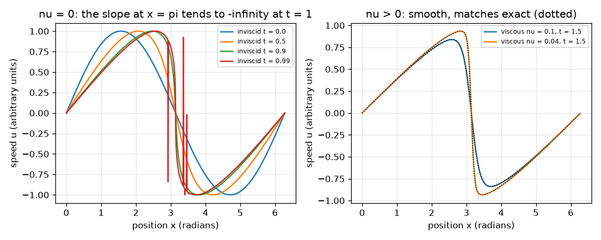
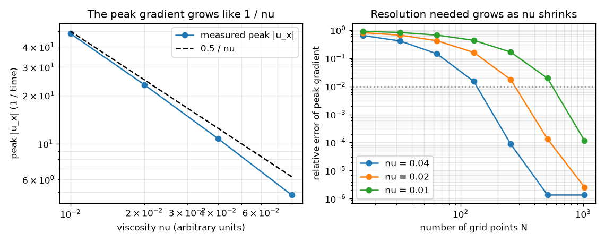

# Session 2: Burgers: steepening against smoothing

*Level 2 (mathematical engineering model) · about 75 minutes · openregularity*

> This is a simplified educational model. It is not a validated design tool and must not be used for real structures, electrical installations, vehicles, industrial processes or medical decisions.

**Prerequisites**

- Session 1.
- Partial derivatives; the idea of a Fourier series (waves added together) is explained in Section B.

**Learning objectives.** After this session you can:

- Derive and check the no-friction shock time t* = 1/max(-u0').
- Use the exact Cole-Hopf solution to show that the viscous Burgers solution is smooth, and verify a spectral solver against it.
- Verify the energy equation dE/dt = -nu mean(u_x^2) numerically.
- Measure how the peak gradient and the needed resolution scale with nu.

## A. Real-world problem
Traffic jams, breaking waves and sonic booms show smooth profiles turning into near-jumps. The 1-D Burgers equation u_t + u u_x = nu u_xx is the simplest equation with this behaviour: the term u u_x steepens, the term nu u_xx smooths. It is NOT Navier-Stokes, but it is a clean laboratory for the competition between the two effects. For Burgers we can prove that solutions stay smooth for every nu > 0. How large does the gradient get as friction shrinks, and how fine must a computer grid be to see it? (Whether the 3-D Navier-Stokes equations always stay smooth is open.)

## B. Concept and theory
Without friction (nu = 0) each point keeps its speed, and the slope along it is u_x = u0'/(1 + t u0'). It becomes infinite at the first time 1 + t u0' = 0, so t* = 1/max(-u0'). For u0 = sin x the steepest slope is -1 at x = pi, so t* = 1, and the slope at x = pi is -1/(1 - t). With friction, the Cole-Hopf substitution u = -2 nu d(ln phi)/dx turns Burgers into the heat equation phi_t = nu phi_xx, solved wave by wave: the solution is smooth for all t when nu > 0. Numerically we store u at N points, differentiate with Fourier waves, remove the top third of the waves (2/3 dealiasing, which avoids folding energy onto long waves) and step in time with RK4 and an integrating factor. Multiplying the equation by u and averaging over the box gives the energy equation dE/dt = -nu mean(u_x^2), E = mean(u^2)/2: energy is lost only through gradients. The Reynolds number is the ratio of nonlinear to viscous effects; here Re = U L / nu = 1/nu with speed U = 1 and length L = 1.

| Symbol | Meaning | Unit |
|---|---|---|
| u(x, t) | speed | arbitrary units |
| nu | viscosity | arbitrary units (length^2 / time) |
| t* | shock time without friction | time |
| E | energy per unit length, mean(u^2)/2 | arbitrary units |
| N | number of grid points | no unit |
| P | peak gradient: maximum over time of max \|u_x\| | 1/time |
| Re | Reynolds number 1/nu in these units | no unit |

**Assumptions**

- Periodic box of length 2 pi and initial speed u0 = sin x.
- The Cole-Hopf formula in double precision is only reliable for nu >= 0.04; below that it fails.
- Time step dt = 0.004 and final time T = 3 unless stated.

$$ u_t+u\,u_x=\nu\,u_{xx} $$

$$ t^{*}=\frac{1}{\max_x\left(-u_0'(x)\right)},\qquad u_x=\frac{u_0'}{1+t\,u_0'} $$

$$ u=-2\nu\,\partial_x\ln\varphi,\qquad \varphi_t=\nu\,\varphi_{xx} $$

$$ \frac{dE}{dt}=-\nu\,\overline{u_x^{2}} $$

$$ P(\nu)=\max_t\max_x|u_x|\ \approx\ \frac{c}{\nu} $$

## C. Visual explanation
The first figure (left) shows the no-friction wave steepening at x = pi as t goes to 1; (right) the viscous solutions at t = 1.5 for nu = 0.1 and 0.04 from the solver, lying on top of the exact Cole-Hopf curves. The second figure plots the peak gradient against nu on log axes: it follows a straight line of slope -1, so halving nu roughly doubles the gradient, and shows how the relative error of the peak falls as N grows: the smaller nu, the larger the N needed.

*No friction: the slope at x = pi tends to minus infinity at t = 1. With friction the solver (colour) lies on the exact solution (dotted).*

*Peak gradient grows like 1/nu (left); the grid size needed for 1 percent accuracy doubles when nu halves (right).*

## D. Interactive simulation
Run the lesson (`python start.py 2`), then open the live app: [Session 2: viscous Burgers (exact Cole-Hopf)](https://krunalpanchal1995.github.io/openregularity/session-02/) (or `app.html` in this folder). Drag nu down on the slope view and watch the slope at x = pi get steeper while the no-friction curve (grey) runs to minus infinity at t = 1. Change t on the profile view.

**Challenge.** Find the smallest viscosity and a time so that the slope at x = pi is steeper than -9 (the steepest is near t = 1.7).

## E. Worked example and experiment
**Problem.** For u0 = sin x without friction, find the shock time and the slope at x = pi at t = 0.9. Then check numerically that with nu = 0.04 the viscous slope stays finite, with its steepest value -10.78 at t = 1.7.

1. u0' = cos x, whose most negative value is -1 at x = pi, so t* = 1/1 = 1.
2. The slope at x = pi is u_x = -1/(1 - t), so at t = 0.9 it is -1/0.1 = -10.
3. With nu = 0.04 the exact Cole-Hopf slope at x = pi and t = 1.7 is -10.78, and the spectral solver's peak gradient is the same number to 1e-4: the profile has a front but no infinity.
4. Check: the no-friction slope at t = 1.7 does not exist (shock formed at t = 1), while the viscous one is finite for every t.

**Answer.** t* = 1; slope -10 at t = 0.9; with nu = 0.04 the largest slope is -10.78, reached around t = 1.7.

**Experiment.** Pour a thin stream of honey and of water over a ramp and watch a wavefront: the fronts are steeper where friction is lower. A better model of traffic (Burgers is a classic traffic model) shows a shock when cars pile up. The model differs from reality because real fluids have pressure, 3-D motion and other physics that Burgers leaves out.

## F. Assessment and design challenge
**Question type A: Conceptual.** Why does the viscous Burgers solution stay smooth although the no-friction solution forms a shock?

Hint

Compare the terms u u_x and nu u_xx when the gradient is very large.

Step-by-step solution

When the gradient is large the viscous term nu u_xx grows too and spreads the front over a width of order nu. With nu > 0 the Cole-Hopf transform gives the heat equation, whose solutions are smooth, so the front stays thin but smooth. This is a statement about Burgers; it is not a proof for 3-D Navier-Stokes.

**Question type B: Numerical.** For u0 = 2 sin x without friction, find the shock time. How does it compare with u0 = sin x?

Hint

Find the most negative value of u0' = 2 cos x.

Step-by-step solution

max(-u0') = 2, so t* = 1/2 = 0.5, half the time for sin x, because the profile is twice as steep.

**Question type C: Graph and simulation interpretation.** In the slope plot, which curve runs to minus infinity, and what does the viscous curve do for nu = 0.04? About when is it steepest?

Hint

Look at the grey curve and at the highest point of the viscous one.

Step-by-step solution

The grey no-friction curve -1/(1 - t) goes to minus infinity at t = 1. The viscous curve (nu = 0.04) reaches a minimum near -10.8 around t = 1.7 and then rises again as friction wins. Units: 1/time.

**Question type D: Design and optimisation challenge.** Design: a simulation of nu = 0.02 must have its peak gradient accurate to 1 percent. Using the convergence study, which power-of-two number of grid points do you need, what happens with half as many, and what about nu = 0.01?

Hint

Compare the errors for N = 256 and N = 512.

Step-by-step solution

N = 512: with N = 256 the error is about 1.7 percent (too large); with N = 512 it is below 0.2 percent. For nu = 0.01 you need N = 1024 (N = 512 gives about 1.9 percent). The needed N doubles when nu halves, because the front width scales with nu. Trade-off: the cost per step also rises and the time step must shrink.

Score yourself with [RUBRIC.md](../../RUBRIC.md). Print the [activity sheet](activity_sheet.md) to work on paper.

## Common misconceptions
| Common misconception | What is actually true |
|---|---|
| Burgers is Navier-Stokes in 1-D, so its results transfer. | Burgers is a toy: its solutions are smooth for all nu > 0, and the 3-D Navier-Stokes question remains open. |
| A very thin front means the solution is not smooth. | Smooth means finite derivatives of every order, not gentle. The gradient 10 or 50 is finite, even if large. |
| Smaller nu makes the energy loss vanish. | The peak dissipation rate stays between 0.07 and 0.11 for all four viscosities tested: the gradient grows like 1/nu while the dissipation per unit gradient squared (nu) shrinks, and the two balance. |
| More grid points always cost the same. | The needed N doubles each time nu halves, so thin fronts are expensive. |

## Glossary
- **shock**: a front where the solution jumps over a very short distance
- **Cole-Hopf transform**: a change of variable that turns Burgers into the heat equation
- **pseudo-spectral method**: derivatives from Fourier waves, products on the grid
- **dealiasing**: removing the highest waves so products do not fold onto low waves
- **dissipation**: loss of energy to friction
- **Reynolds number**: ratio of nonlinear to viscous effects; here 1/nu

## Finish
1. Do the three coding tasks in [exercises.md](exercises.md).
2. Run `python start.py 2` again after your changes. It ends with the checkpoint; when it prints `PASS`, you are done. (Checkpoint only: `python start.py check 2`.)

Next: [Session 3](../session-03/README.md)
