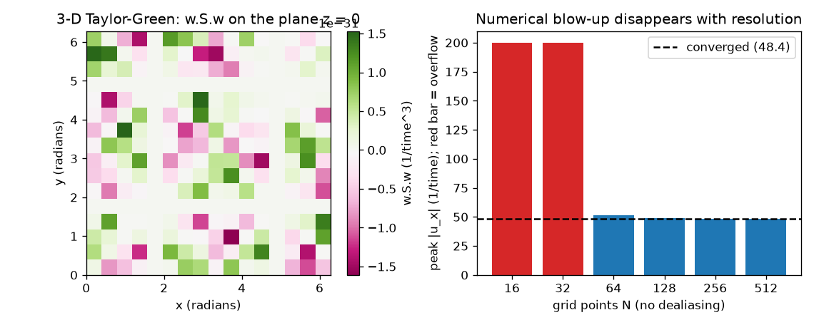
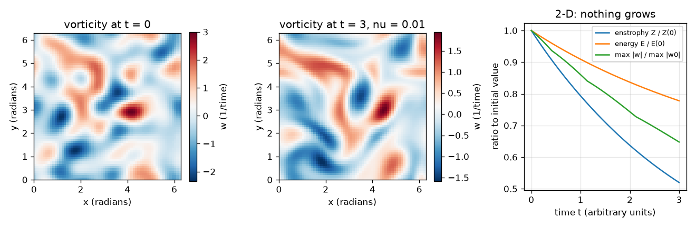

# Session 3: 2-D flow, 3-D vortex stretching, and numerical blow-up

*Level 3 (simulation and validation) · about 90 minutes · openregularity*

> This is a simplified educational model. It is not a validated design tool and must not be used for real structures, electrical installations, vehicles, industrial processes or medical decisions.

**Prerequisites**

- Sessions 1 and 2.
- Vectors and the idea of curl (spin of a flow); explained in Section B.

**Learning objectives.** After this session you can:

- Solve 2-D incompressible Navier-Stokes in vorticity form with a pseudo-spectral method and check it against the exact Taylor-Green decay.
- Verify numerically the energy and enstrophy balances, and that 2-D enstrophy cannot grow.
- Evaluate the 3-D vortex stretching term on a given field and explain why it is absent in 2-D, while stating that the 3-D problem is open.
- Recognise a numerical blow-up as a possible artefact, and remove it by adding resolution.

## A. Real-world problem
A weather map is nearly 2-D; the air behind an aircraft is 3-D. For 2-D flow we know that smooth solutions exist for all time. For 3-D flow we do not: the 3-D question is open and carries a Millennium Prize. What is different in 3-D? The vorticity (spin of the fluid) can be stretched by the flow, like a spinning ice skater pulling in their arms. This session shows the difference on a computer, without claiming anything about the open problem. It also asks a practical question: when a simulation 'blows up', is the equation singular or is the code under-resolved?

## B. Concept and theory
In 2-D the vorticity w = v_x - u_y is one number per point. With a stream function psi (u = psi_y, v = -psi_x), laplacian(psi) = -w and w_t + u w_x + v w_y = nu laplacian(w). Vorticity is only carried and diffused; nothing stretches it. Consequences, for nu > 0 on a periodic box: the maximum of |w| cannot exceed its initial value (the exact statement is a maximum principle), energy obeys dE/dt = -2 nu Z, and enstrophy Z = mean(w^2)/2 obeys dZ/dt = -2 nu P with P = mean(|grad w|^2)/2 >= 0, so Z never grows. These facts are the reason 2-D global regularity is known. In 3-D the vorticity vector w = curl u obeys an equation with the extra term (w . grad) u = S w, where S is the strain (symmetric part of the velocity gradient). The number w . S w is positive where vortex lines are stretched. Nobody knows whether this term can drive a blow-up of smooth solutions; that is the open problem. Known 3-D results (from the literature): global weak solutions exist (Leray); smooth solutions exist for a short time (Ladyzhenskaya, Kato and others); the Beale-Kato-Majda criterion says a blow-up would require the time integral of the maximum vorticity to be infinite; Prodi-Serrin type conditions say smoothness persists if the velocity is controlled in certain norms; and Caffarelli-Kohn-Nirenberg proved that the possible singular set of suitable weak solutions is small. None of these settles the question. We implement 2-D with 2/3 dealiasing and RK4 with an integrating factor, and evaluate w . S w with spectral derivatives on the 3-D Taylor-Green field.

| Symbol | Meaning | Unit |
|---|---|---|
| w | vorticity (spin) in 2-D | 1/time |
| u, v | velocity components | length/time |
| psi | stream function | length^2/time |
| nu | viscosity | length^2/time |
| E | energy mean(u^2+v^2)/2 | length^2/time^2 |
| Z | enstrophy mean(w^2)/2 | 1/time^2 |
| P | palinstrophy mean(\|grad w\|^2)/2 | 1/(length^2 time^2) |
| k | wavenumber of the Taylor-Green flow | no unit |
| S | strain tensor, symmetric part of grad u | 1/time |

**Assumptions**

- Periodic box [0, 2 pi)^2 (or the cube for the 3-D field), no forcing.
- Incompressible flow with constant density.
- The 3-D computation evaluates a term on a given field; it does not solve the 3-D equations.
- Resolution and time step are small enough, as checked by the balances.

$$ w_t+u\,w_x+v\,w_y=\nu\,\Delta w,\qquad \Delta\psi=-w $$

$$ w(x,y,t)=2k\sin kx\,\sin ky\;e^{-2\nu k^{2}t}\quad\text{(Taylor-Green, exact)} $$

$$ \frac{dE}{dt}=-2\nu Z,\qquad \frac{dZ}{dt}=-2\nu P\le 0 $$

$$ \partial_t\boldsymbol\omega+(\mathbf u\cdot\nabla)\boldsymbol\omega=(\boldsymbol\omega\cdot\nabla)\mathbf u+\nu\Delta\boldsymbol\omega,\qquad (\boldsymbol\omega\cdot\nabla)\mathbf u=S\boldsymbol\omega $$

$$ \int_0^{T}\|\boldsymbol\omega(t)\|_\infty\,dt<\infty\ \Rightarrow\ \text{smooth up to }T\quad\text{(Beale-Kato-Majda)} $$

## C. Visual explanation
The first figure shows the 2-D random initial vorticity (blobs of spin of both signs), the same field at t = 3 for nu = 0.01 (smoother and weaker), and three curves, all decreasing: enstrophy, energy and the maximum vorticity, each divided by its starting value. The second figure shows the 3-D Taylor-Green quantity w . S w on the plane z = 0, red where vortex lines stretch and green where they compress, and a bar chart of the Burgers peak gradient for nu = 0.01 without dealiasing: the two coarsest grids overflow (red bars), then the bars settle on the converged value.

*3-D Taylor-Green stretching term w . S w on one plane (left); Burgers peak gradient without dealiasing: coarse grids overflow, finer grids converge (right).*

*Random 2-D vorticity at t = 0 and t = 3 (nu = 0.01), with decaying enstrophy, energy and maximum vorticity.*

## D. Interactive simulation
Run the lesson (`python start.py 3`), then open the live app: [Session 3: Taylor-Green vortices in 2-D](https://krunalpanchal1995.github.io/openregularity/session-03/) (or `app.html` in this folder). Choose the wavenumber k and viscosity nu and watch the vorticity field fade; open the amplitude and enstrophy views and see that both only decay, with the dashed tangent showing the enstrophy balance.

**Challenge.** Make the vorticity amplitude fall below 10 percent of its start while nu is at most 0.1.

## E. Worked example and experiment
**Problem.** Check the Taylor-Green solution with nu = 0.05 and k = 1 at t = 2: predict the maximum vorticity and the energy ratio E(2)/E(0), then compare with the solver.

1. w0 = 2 sin x sin y has maximum 2. The exact decay factor is exp(-2 nu t) = exp(-0.2) = 0.8187.
2. So the maximum vorticity at t = 2 is 2 * 0.8187 = 1.637 (1/time).
3. Energy decays like exp(-4 nu t) = exp(-0.4) = 0.670, starting from E(0) = 0.25.
4. The solver on a 32 by 32 grid gives the same maximum and ratio; the largest pointwise difference from the exact field is about 1e-14. The nonlinear term vanishes identically for this flow, so only viscosity acts.

**Answer.** Maximum vorticity 1.637 (1/time) and E(2)/E(0) = 0.670, matching the solver.

**Experiment.** Stir a cup of tea and stop stirring: the swirls decay because of viscosity, and the decay is faster for small swirls (larger k decays like exp(-2 nu k^2 t)). A real cup is 3-D, has walls and turbulence, so decay is not exactly exponential. The periodic 2-D model leaves out walls, 3-D motion and instabilities.

## Real-world application and mini-project: How many Fourier modes does a thin front need?
Choose the viscosity nu = 0.015. Use `convergence_report` from Session 3 (or your own solver) to run the Burgers equation for u0 = sin x up to t = 3 on N = 32, 64, ..., 2048 points without looking at the exact answer. Report a table of N, the peak gradient (largest |u_x| over time) and the change from one size to the next up. Declare the solution converged at the first N whose peak changes by less than 1 percent when N doubles. Then write three sentences explaining why a run that reports a smaller peak on a coarse grid is not evidence that the true gradient is small.

**Deliverable:** A script that prints the convergence table for nu = 0.015, names the converged N, and saves a plot of peak gradient against N on a log axis, with a short written conclusion.

**Success looks like:** The converged size is N = 512 with peak gradient 31.6; going from 256 to 512 changes the peak by 5.4 percent and from 512 to 1024 by only 0.2 percent.

## F. Assessment and design challenge
**Question type A: Conceptual.** Why does 2-D vorticity have no stretching, and why does that help the regularity question there? Does this settle 3-D?

Hint

In 2-D the vorticity points out of the plane and velocity does not vary along that direction.

Step-by-step solution

In 2-D the vorticity vector is perpendicular to the plane and the velocity has no component or variation along that direction, so (w . grad) u = 0. Vorticity is only carried and diffused, which gives the maximum principle and the enstrophy bound, and global smoothness is known. In 3-D the stretching term is present and global smoothness is not known; the problem is open, so nothing here settles it.

**Question type B: Numerical.** For the Taylor-Green flow with k = 2, nu = 0.05, find the initial enstrophy and the decay factor of the vorticity at t = 0.5.

Hint

Z0 = k^2/2 and the factor is exp(-2 nu k^2 t).

Step-by-step solution

Z0 = 4/2 = 2 (1/time^2). Factor = exp(-2 * 0.05 * 4 * 0.5) = exp(-0.2) = 0.819. The solver reproduces this decay to 1e-10 in the checkpoint.

**Question type C: Graph and simulation interpretation.** In the random 2-D run (nu = 0.01), the enstrophy drops from 0.356 to 0.185. What fraction is left, and what would a rise of the curve indicate?

Hint

Divide the two numbers; recall dZ/dt = -2 nu P with P at least 0.

Step-by-step solution

0.185/0.356 = 0.52, so 52 percent is left. A rise would contradict dZ/dt <= 0 for 2-D flow: it would signal a bug, a time step that is too large, or missing resolution.

**Question type D: Design and optimisation challenge.** Design: you simulate Burgers with nu = 0.01 and see the solution overflow on a 32-point grid without dealiasing. List what you would change, in order, before claiming anything about singularities, and say what evidence would be convincing.

Hint

Think of resolution, dealiasing, time step, and comparing several grids.

Step-by-step solution

First add dealiasing (the 2/3 rule) and check the time step; then repeat on N = 64, 128, 256, 512 and 1024 and watch the peak gradient converge: without dealiasing the peaks are 51.1, 48.8 and 48.4 for N = 64, 128, 256, and with dealiasing and N = 1024 it is 48.4. Convincing evidence of a real singularity would need convergence under refinement of a growing quantity, error bounds, and ideally a computer-assisted proof. Here the true solution is smooth for every nu > 0, so the overflow was purely numerical. Trade-off: more resolution costs more computing.

Score yourself with [RUBRIC.md](../../RUBRIC.md). Print the [activity sheet](activity_sheet.md) to work on paper.

## Common misconceptions
| Common misconception | What is actually true |
|---|---|
| A simulation that goes to infinity shows the equation blows up. | It may only show that the grid or the scheme is too coarse. Check by refining; real evidence needs convergence studies, error bounds or proofs. |
| Because 2-D is understood, 3-D must behave the same. | The stretching term (w . grad) u exists only in 3-D, and 3-D global smoothness is an open problem. |
| Too few grid points just gives a blurry answer. | A coarse dealiased run can report a smooth, finite and wrong peak: at N = 16 it reports about 4.9 while the true value is 48.4. |
| Energy and enstrophy behave the same way. | They both decay in 2-D viscous flow, but only 2-D enstrophy is non-increasing for a structural reason; in 3-D enstrophy can be produced by stretching. |

## Glossary
- **vorticity**: twice the local spin rate of the fluid; the curl of velocity
- **stream function**: a scalar whose derivatives give the 2-D velocity
- **enstrophy**: half the mean of vorticity squared
- **vortex stretching**: growth of vorticity as vortex lines are stretched by the flow
- **Beale-Kato-Majda criterion**: smoothness continues as long as the time integral of the maximum vorticity is finite
- **aliasing**: high waves wrongly appearing as low waves when products are formed on a grid

## Finish
1. Do the three coding tasks in [exercises.md](exercises.md).
2. Run `python start.py 3` again after your changes. It ends with the checkpoint; when it prints `PASS`, you are done. (Checkpoint only: `python start.py check 3`.)

Next: the [roadmap](../../promo/roadmap.md). Session 4 is yours to build.
